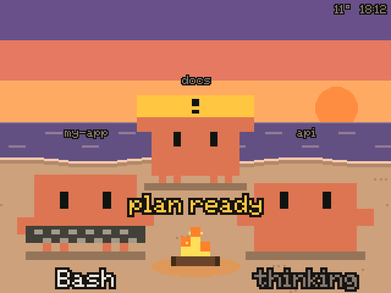
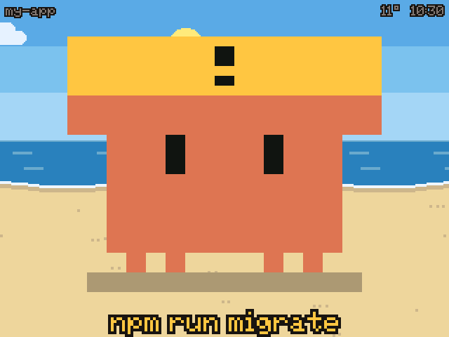
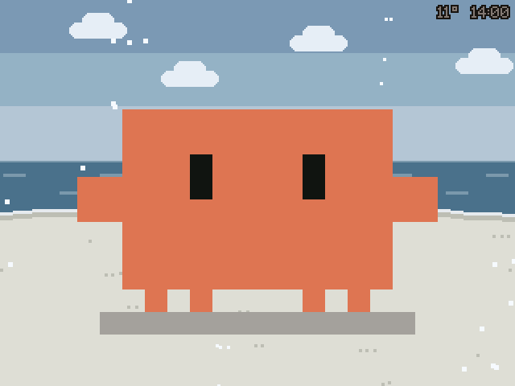

# Clawd desk pet

[中文](README.zh-CN.md)

A pixel Clawd that lives on a tiny beach on your desk and shows what Claude Code is doing. Claude Code hooks push every state change to an M5Stack screen over Wi-Fi.

> Unofficial fan project. Clawd is Anthropic's mascot; this project is not affiliated with or endorsed by Anthropic.

<p>
  
  
  
</p>

| State | When | What Clawd does |
| --- | --- | --- |
| thinking | after you send a message, between tool calls | hops, looks up, thought dots |
| working | while a tool runs | holds a prop for the tool, tool name at the bottom |
| waiting | a permission prompt, a question, or a plan waiting for you | stomps, raises a "!" sign and beeps; the question or command is shown |
| done | Claude finished its turn | jumps, confetti, back to idle after 60 s |
| idle | nothing going on | blinks, looks around, waves, blows bubbles, walks a few steps |
| sleep | 10 minutes of quiet, or all sessions ended | nightcap, z's, screen dims |

Props: Bash types on a keyboard, Edit/Write writes with a pencil, Read/Grep/Glob wears glasses, WebSearch/WebFetch uses a telescope, Task/Agent splits into three.

**One crab per session.** Up to three busy sessions sit in a half circle around a sandcastle (day) or a campfire (evening and night), each with its project name. New sessions walk in from the side; finished ones wave and walk off.

**The beach follows your clock.** Dawn, day, dusk and night blend into each other; the sun moves along an arc, the moon and stars come out at night. A clock sits in the corner. Optional live weather from [Open-Meteo](https://open-meteo.com/) (no API key): clouds, overcast, fog, rain, snow and thunderstorms with lightning. Sailboats, gulls, shooting stars and fireflies drift by now and then.

**Touch it.** Tap its body and it blushes, tap its eyes and it blinks, tap a claw and it waves back, hold to tickle, tap four times quickly and it gets angry. Tapping a waiting or done crab acknowledges it.

## Hardware

Tested only on the **M5Stack CoreS3 SE** (2" 320×240 touchscreen, speaker; it has no battery, so keep it on USB power). The code uses M5Unified, so the CoreS3 should work too. The multi-crab layout is tuned for 320×240; other screen sizes will need adjustments.

## 1. Flash the firmware

1. Copy `firmware/clawd_pet/secrets.example.h` to `secrets.h` and fill in:
   - Wi-Fi name and password (2.4 GHz only)
   - `TZ_INFO`, your POSIX time zone (examples are in the file)
   - optionally `WEATHER_LAT` / `WEATHER_LON` for weather, and `OTA_PASS` for over-the-air updates
2. Install the board package and libraries. With [arduino-cli](https://arduino.github.io/arduino-cli/):

   ```bash
   arduino-cli config add board_manager.additional_urls https://static-cdn.m5stack.com/resource/arduino/package_m5stack_index.json
   arduino-cli core update-index && arduino-cli core install m5stack:esp32
   arduino-cli lib install M5Unified M5GFX
   ```

   In the Arduino IDE: add the same URL under board manager URLs, install **M5Stack**, then install **M5Unified** from the library manager.
3. Plug in over USB and upload:

   ```bash
   arduino-cli compile --upload -p /dev/cu.usbmodem* --fqbn m5stack:esp32:m5stack_cores3 firmware/clawd_pet
   ```

4. After boot the screen shows `clawd.local`. Test it:

   ```bash
   curl -4 "http://clawd.local/state?s=waiting&label=hello"
   ```

   Always use `curl -4`: on macOS, `.local` names try IPv6 first and can hang until the timeout.

Later updates can go over Wi-Fi:

```bash
arduino-cli compile --fqbn m5stack:esp32:m5stack_cores3 firmware/clawd_pet
arduino-cli upload -p <device IP> --protocol network --upload-field password=<OTA_PASS> --fqbn m5stack:esp32:m5stack_cores3 firmware/clawd_pet
```

## 2. Connect Claude Code

```bash
mkdir -p ~/.claude/hooks && cp hooks/clawd.sh ~/.claude/hooks/ && chmod +x ~/.claude/hooks/clawd.sh
```

Then merge the `hooks` section of `hooks/settings-snippet.json` into `~/.claude/settings.json`. If you already have hooks, merge event by event instead of overwriting. Back up the file first.

Every hook is `async` and the script always exits 0, so an offline device never slows Claude down. The script needs `curl` and `jq`. If `clawd.local` doesn't resolve on your network, set `export CLAWD_HOST=<device IP>` in your shell profile.

## HTTP API

| Endpoint | Purpose |
| --- | --- |
| `GET /state?s=<state>&sid=<session>&name=<project>&label=<text>&t=<ms>` | set a session's state (`idle`, `thinking`, `working`, `waiting`, `done`, `sleep`); `t` drops out-of-order requests |
| `GET /` | JSON with the most urgent state, time, weather and all sessions |
| `GET /shot` | screenshot as a 24-bit BMP |
| `GET /test?antic=walk` / `react=angry&i=0` / `hour=6.5` / `weather=rain` / `event=boat` | trigger animations, fake the time or weather (`hour=-1`, `weather=auto` to reset) |
| `GET /rec?on=1`, `GET /frame?n=1` | frame-stepped recording: the clock freezes and each `/frame` advances 40 ms and returns an RLE frame (used by `promo/`) |

## Known limitations

- With more than three busy sessions, only the three most urgent are shown.
- Pressing Esc doesn't fire a Stop hook. Clawd goes back to idle when Claude Code sends its idle notification (about a minute later) or after 5 minutes without messages.
- After you approve a permission, Clawd keeps showing waiting until the tool finishes.
- Code comments are in Chinese.

## License

MIT, see [LICENSE](LICENSE). Clawd's likeness belongs to Anthropic.
